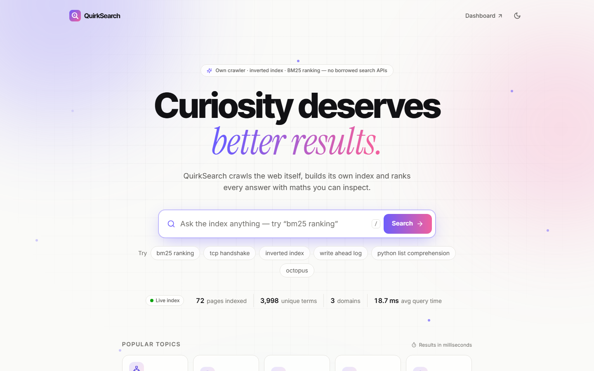
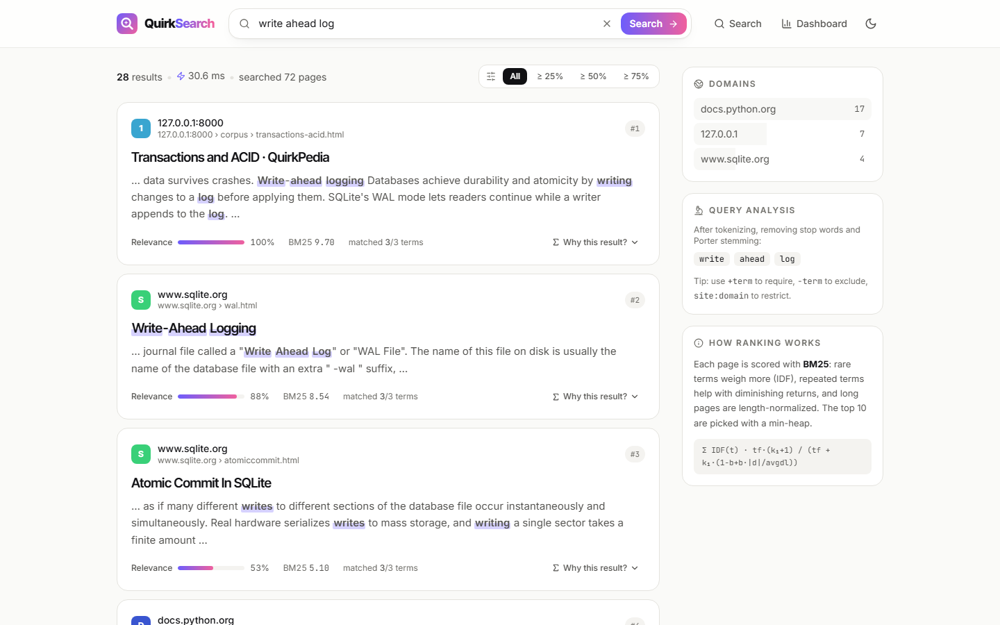
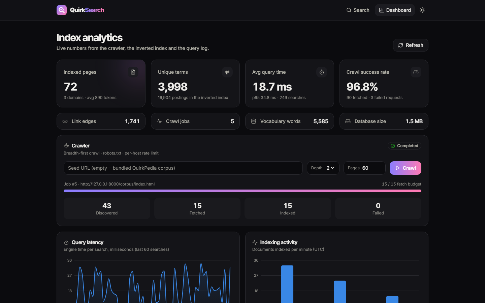
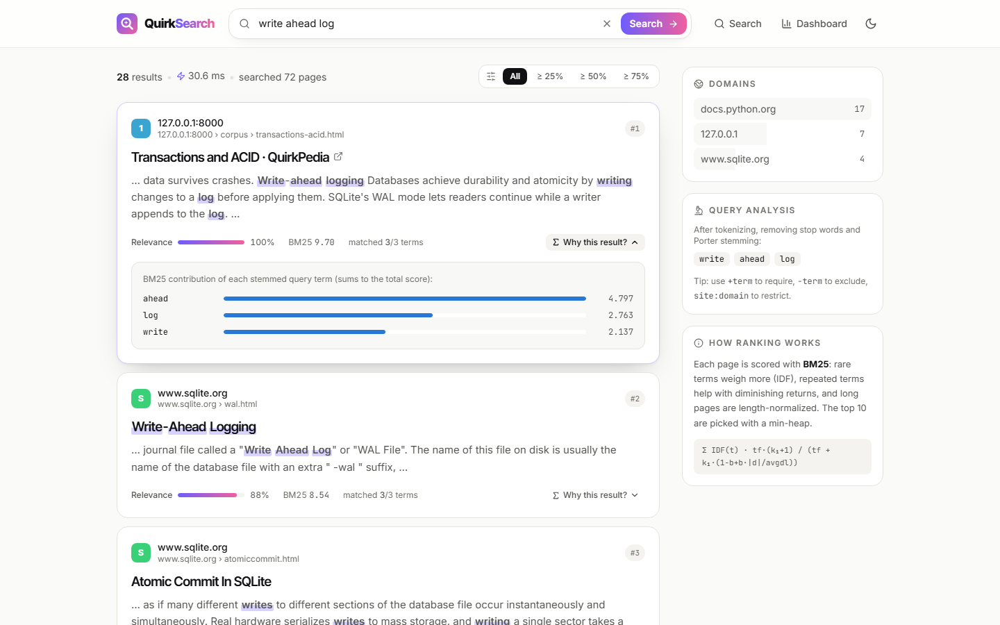
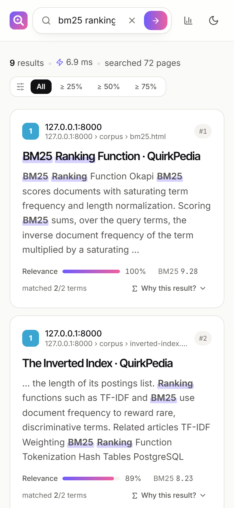
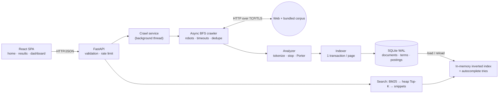

<p align="center">
  
</p>

<h1 align="center">QuirkSearch</h1>
<p align="center"><em>Curiosity deserves better results.</em></p>

QuirkSearch is a **search engine built from scratch**: its own asynchronous web crawler, a
Porter-stemmed **inverted index** persisted in **SQLite**, **BM25** ranking with heap-based
**Top-K** retrieval, a **FastAPI** REST API and a polished **React** interface with an analytics
dashboard. No Google, Bing or other search API is used anywhere — every result is crawled,
indexed and ranked by this code.



📄 **Full technical report:** [`QuirkSearch_Technical_Report.pdf`](QuirkSearch_Technical_Report.pdf) (architecture, diagrams, BM25 maths, schema, tests, measured performance).

---

## Features

| | |
|---|---|
| **Crawler** | Concurrent BFS over the link graph · robots.txt (RFC 9309) + Crawl-delay · per-host rate limiting · connect/read timeouts · redirects · 2 MB cap · URL canonicalization (RFC 3986, IDNA) · SHA-256 duplicate detection · `noindex`/`nofollow` · typed error log |
| **Text processing** | Unicode normalization · tokenizer · stop words · **Porter stemmer written from the 1980 paper** · title/heading field weights |
| **Index & database** | Hash-map inverted index (term → {doc: tf}) · 10-table 3NF SQLite schema with PK/FK/CHECK constraints · triggers keep document frequencies exact · one ACID transaction per page · WAL · incremental re-indexing |
| **Search** | BM25 (k₁ = 1.2, b = 0.75) · heap Top-K · pagination · `+must`, `-exclude`, `site:` operators · domain facets · highlighted best-window snippets · "Why this result?" per-term score breakdown · "Did you mean" (Levenshtein) · trie autocomplete |
| **API** | 11 REST endpoints · validation · JSON errors · token-bucket rate limiting (429) · background crawl jobs · OpenAPI docs at `/docs` |
| **UI** | Landing page · results page · analytics dashboard with charts and live crawl control · light/dark themes · mobile layouts · skeleton/empty/error states |

**Measured on the running system** (72 pages, 3,998 terms; see `docs/benchmarks.json`):
retrieval + ranking **0.14 ms** mean · full search with snippets **16 ms** median · HTTP end-to-end
**35 ms** median · inverted index **≈4,800×** faster than a linear scan · **152 tests, 94 % coverage**.

## Prerequisites

* **Python 3.11+** (developed on 3.13)
* **Node.js 18+** and npm (developed on Node 22)
* Internet access is *optional*: the bundled corpus is served and crawled locally.

## Installation

```bash
# Backend
cd backend
python -m venv .venv
.venv\Scripts\activate            # macOS/Linux: source .venv/bin/activate
pip install -r requirements.txt

# Frontend
cd ../frontend
npm install
```

## Running the backend

```bash
cd backend
uvicorn quirksearch.main:app --port 8000
```

On first start with an empty database, the server **automatically crawls the bundled
QuirkPedia corpus** (39 linked articles served by the backend itself at `/corpus`) over real HTTP,
so search works within ~25 seconds. API docs: <http://127.0.0.1:8000/docs>.

Configuration is via environment variables (`QS_DB_PATH`, `QS_MAX_PAGES`, `QS_MAX_DEPTH`,
`QS_CONCURRENCY`, `QS_PER_HOST_DELAY`, `QS_READ_TIMEOUT`, `QS_PUBLIC_BASE_URL`, `QS_CORS_ORIGINS`;
see `backend/quirksearch/config.py`). If you run on a different host/port, set
`QS_PUBLIC_BASE_URL` so the auto-seed crawl can reach the corpus.

## Running the frontend

```bash
cd frontend
npm run dev          # http://localhost:5173 (proxies /api → 127.0.0.1:8000)
```

Or build once and let FastAPI serve everything from one origin:

```bash
npm run build        # then open http://127.0.0.1:8000
```

## Crawling documents

* **Dashboard:** open *Dashboard → Crawler*, enter a seed URL (or leave empty for the bundled
  corpus), choose depth and page budget, press **Crawl**. Progress updates live; **Stop** cancels.
* **API:**

  ```bash
  curl -X POST http://127.0.0.1:8000/api/crawl -H "Content-Type: application/json" \
       -d '{"seeds": ["https://www.sqlite.org/lang.html"], "max_depth": 1, "max_pages": 20}'
  curl http://127.0.0.1:8000/api/crawl/status
  ```

Crawls stay on the seeds' domains by default, honour robots.txt and wait ≥0.5 s between requests to
the same host. Some sites refuse unidentified bots (e.g. Wikipedia returns 403); QuirkSearch
respects that rather than impersonating a browser.

## Executing searches

Type in the search box (press <kbd>/</kbd> anywhere to focus it), or call the API:

```bash
curl "http://127.0.0.1:8000/api/search?q=bm25+ranking&page=1&page_size=10"
```

Query syntax: `write ahead log` (ranked OR) · `+heap sorting` (must contain *heap*) ·
`database -sqlite` (exclude) · `transactions site:www.sqlite.org` (restrict domain).

## API endpoints

| Method | Path | Purpose |
|---|---|---|
| GET | `/api/search?q=&page=&page_size=&domain=` | Ranked results, facets, timing, spelling suggestion |
| GET | `/api/suggestions?q=&limit=` | Autocomplete |
| GET | `/api/stats` | Analytics for the dashboard |
| GET | `/api/documents?page=&page_size=&domain=` | Indexed documents |
| GET | `/api/documents/{id}` | One document with index metadata |
| POST | `/api/crawl` | Start a background crawl (202; 409 if one is running) |
| GET | `/api/crawl/status?job_id=` | Job progress, live counters, recent errors |
| GET | `/api/crawl/jobs` | Recent jobs |
| POST | `/api/crawl/cancel` | Stop the running crawl |
| POST | `/api/index/reload` | Reload the in-memory index from the database |
| GET | `/api/health` | Liveness and index summary |

## Screenshots

| Results | Dashboard (dark) |
|---|---|
|  |  |
| **"Why this result?"** | **Mobile** |
|  |  |

All screenshots are captured from the running app by `backend/scripts/screenshots.py` (Playwright).

## Architecture overview



```
backend/quirksearch/
  crawler/   url_utils · fetcher · robots · parser · crawler     (Computer Networks)
  text/      analyzer · porter · stopwords                        (tokenization, stemming)
  index/     indexer · inverted_index · trie                      (DSA)
  search/    bm25 · searcher · snippets                           (ranking, Top-K)
  db/        schema.sql · database · repository                   (DBMS)
  services/  crawl_service        api/  routes · schemas · ratelimit        main.py
frontend/src/  pages/ (Home, Results, Dashboard) · components/ · lib/
docs/          ARCHITECTURE.md · benchmarks.json · screenshots/ · report/
```

More detail: [`docs/ARCHITECTURE.md`](docs/ARCHITECTURE.md) and the PDF report.

## Testing and measurements

```bash
cd backend
pytest --cov=quirksearch            # 152 tests (crawler tests use a real localhost HTTP server)
python scripts/benchmark.py         # writes docs/benchmarks.json (needs the server for HTTP figures)
python scripts/screenshots.py       # refreshes docs/screenshots (needs: pip install playwright && playwright install chromium)
python ../docs/report/build_report.py   # rebuilds the PDF report from real test/benchmark data
```

## Limitations

No phrase/proximity search (positions are not stored), no JavaScript rendering, English-only
analysis, exact (not near-) duplicate detection, single-node SQLite. See §25–26 of the report for
details and planned enhancements (PageRank over the stored link graph, positional index, PostgreSQL,
Docker packaging).
