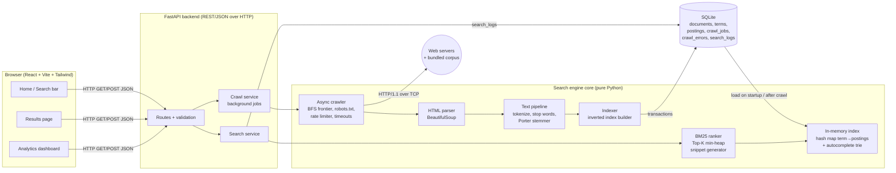

# QuirkSearch — Architecture

> *Curiosity deserves better results.*

QuirkSearch is a self-contained search engine. It **crawls** pages over HTTP, **parses and
normalizes** their text, builds an **inverted index** persisted in **SQLite**, and answers
queries with **BM25** ranking and **heap-based Top-K** retrieval. A React single-page app
provides the search experience and an analytics dashboard. No third-party search API is used
anywhere.

## 1. System architecture



## 2. Folder structure

```
search engine/
├── backend/
│   ├── quirksearch/              Python package (the engine + API)
│   │   ├── config.py             Settings (env-driven): paths, crawl limits, BM25 params
│   │   ├── main.py               FastAPI app factory, startup wiring, static corpus mount
│   │   ├── api/                  REST layer
│   │   │   ├── routes.py         /api/search, /suggestions, /stats, /documents, /crawl, /health
│   │   │   └── schemas.py        Pydantic request/response models (validation)
│   │   ├── crawler/              Computer-networks heavy module
│   │   │   ├── url_utils.py      URL normalization, domain checks, hashing
│   │   │   ├── robots.py         robots.txt cache + permission checks
│   │   │   ├── fetcher.py        async HTTP client, timeouts, per-host rate limiting
│   │   │   ├── parser.py         HTML → title, description, headings, paragraphs, links
│   │   │   └── crawler.py        BFS graph traversal, concurrency, dedupe, persistence
│   │   ├── text/                 Text processing
│   │   │   ├── stopwords.py      English stop-word set
│   │   │   ├── porter.py         Porter stemmer (implemented from the 1980 paper)
│   │   │   └── analyzer.py       normalize → tokenize → stop → stem pipeline
│   │   ├── index/
│   │   │   ├── indexer.py        Builds per-doc term frequencies, writes postings in a txn
│   │   │   ├── memory_index.py   Hash-map inverted index loaded from DB for fast queries
│   │   │   └── trie.py           Prefix trie for autocomplete
│   │   ├── search/
│   │   │   ├── bm25.py           BM25 scoring functions
│   │   │   ├── searcher.py       Query processing, Top-K heap, filters, pagination
│   │   │   └── snippets.py       Best-window snippet extraction + highlight segments
│   │   ├── db/
│   │   │   ├── schema.sql        DDL: tables, PK/FK, CHECKs, indexes
│   │   │   ├── database.py       Connection factory, PRAGMAs, migrations, txn helper
│   │   │   └── repository.py     All SQL lives here (repository pattern → swappable DB)
│   │   └── services/
│   │       └── crawl_service.py  Background crawl-job manager (one job at a time)
│   ├── corpus/                   Bundled HTML corpus served at /corpus (works offline)
│   ├── scripts/                  CLI: crawl, reindex, benchmark
│   ├── tests/                    Pytest suite (crawler, index, ranking, DB, API)
│   └── data/                     SQLite database file (git-ignored)
├── frontend/                     React + Vite + Tailwind SPA
│   └── src/
│       ├── pages/                Home, Results, Dashboard
│       ├── components/           Logo, SearchBar, ResultCard, StatCard, charts, skeletons
│       └── lib/api.js            Typed fetch wrapper for the REST API
├── docs/                         Architecture, diagrams, screenshots, report sources
├── README.md
├── PROJECT_STATUS.md
└── QuirkSearch_Technical_Report.pdf
```

## 3. Module responsibilities

| Module | Responsibility | Key CS concept |
|---|---|---|
| `crawler.url_utils` | Canonicalize URLs (scheme/host lowercase, drop fragments & default ports, sort query) | URL/DNS structure, hashing |
| `crawler.robots` | Fetch & cache `robots.txt` per host; deny disallowed paths | Network etiquette |
| `crawler.fetcher` | `httpx.AsyncClient`, connect/read timeouts, redirects, per-host min-delay | HTTP over TCP, rate limiting |
| `crawler.crawler` | BFS over the link graph with a depth limit, `visited` hash set, content-hash dedupe, bounded concurrency (`asyncio.Semaphore`) | Graph traversal, concurrency |
| `text.analyzer` | Lowercase, strip punctuation, tokenize, stop words, stem | Tokenization |
| `index.indexer` | Term frequencies per doc (field-weighted), upsert `terms.doc_freq`, insert `postings` inside one transaction | Inverted index, ACID |
| `index.memory_index` | `dict[term] → list[(doc_id, tf)]` loaded from DB; doc-length table | Hash maps |
| `index.trie` | Prefix completion over vocabulary & past queries | Trie |
| `search.searcher` | Parse query, accumulate BM25 scores, `heapq` Top-K, domain filter, paging | Heap / priority queue |
| `db.repository` | Every SQL statement; parameterized queries; indexes chosen for access paths | DBMS |
| `api.routes` | Validation, error mapping, latency measurement, search logging | REST |

## 4. Implementation roadmap

| Phase | Deliverable | Exit criteria |
|---|---|---|
| 1 | Architecture, folders, env, status file | Structure exists, deps install |
| 2 | Crawler + bundled corpus | Tests: fetch/extract, dedupe, robots, errors |
| 3 | Text pipeline + indexer | Postings & DFs verified on known docs |
| 4 | Database schema + repository | Constraints enforced, data survives restart |
| 5 | BM25 + Top-K + snippets | Relevance tests on sample queries pass |
| 6 | FastAPI routes | Endpoint tests pass, manual curl verified |
| 7 | Frontend (home, results, dashboard) | Wired to live API, responsive |
| 8 | Full test pass + latency benchmark | All green, measurements recorded |
| 9 | README + PDF technical report | Real screenshots & measurements |

## 5. Key design decisions

* **SQLite + repository layer.** Zero setup, ACID, real FK/indexes. All SQL is isolated in
  `repository.py`, so PostgreSQL could be swapped in by reimplementing one module.
* **Persisted index, cached in memory.** Postings live in SQLite (durable, queryable); at
  startup and after each crawl they are loaded into a hash map so a query touches only the
  postings lists of its terms — never a table scan.
* **BM25** over TF-IDF: saturating term frequency and length normalization give noticeably
  better rankings on pages of very different lengths.
* **Bundled corpus served over real HTTP.** The backend serves `backend/corpus/` at
  `/corpus/`, and the crawler fetches it through the same network stack it uses for the open
  web (robots.txt, timeouts, rate limits). The engine works immediately and offline, while
  live crawling of external sites remains available with conservative limits.
